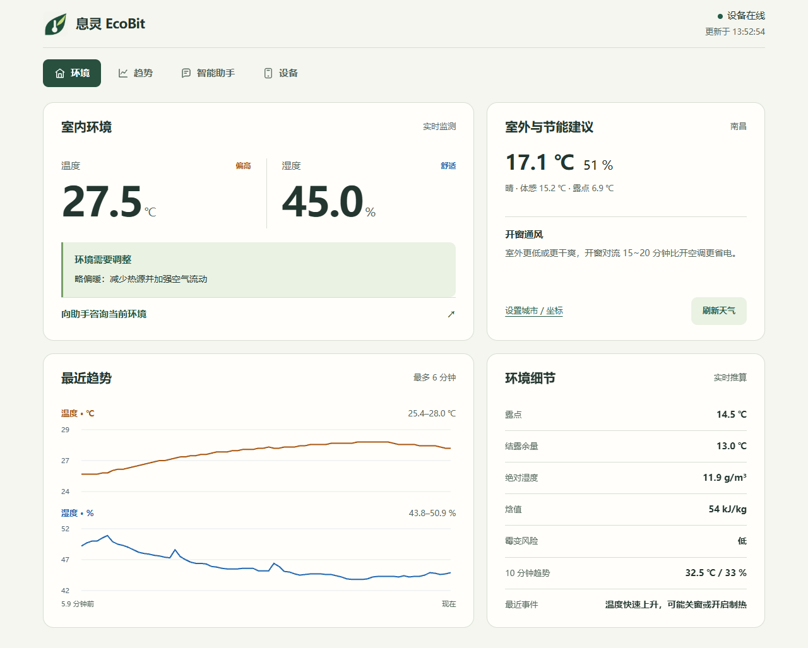
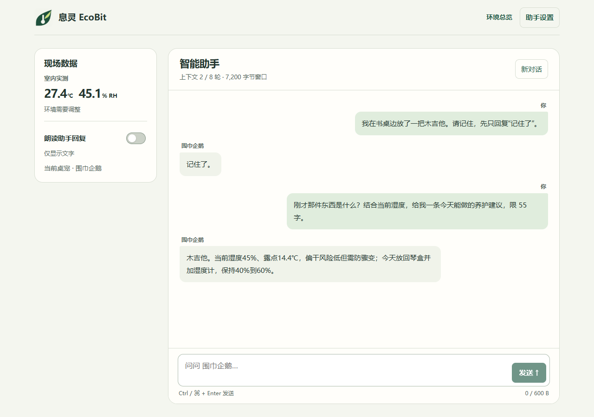
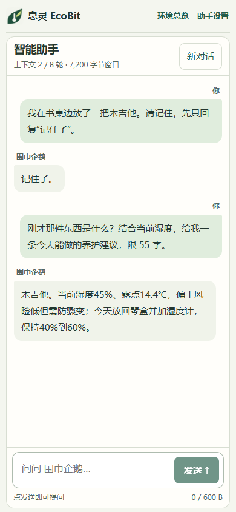
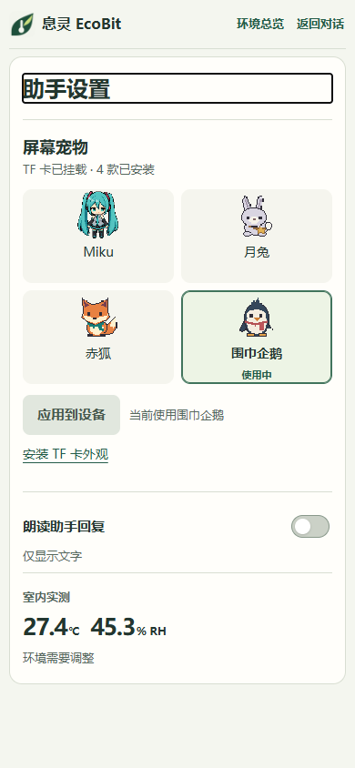
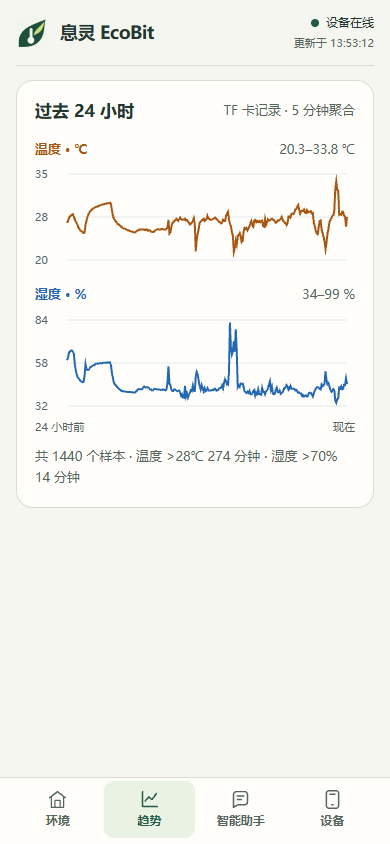
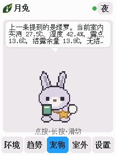

# EcoBit-esp32 · 息灵 EcoBit

**一块触摸屏就能查看房间的温湿度、观察一天的变化，还能和屏幕上的宠物讨论要不要开窗。** 息灵 EcoBit 运行在 ESP32-2432S028R（CYD）上，使用 SHT3x 采集室内温湿度。开发板自带手机网页；电脑上位机提供实时总览、独立聊天页和越界通知。



## 和助手一起看数据

在「智能助手」里可以问“现在适合开窗吗？”，再追问判断依据。每条请求会带上室内实测值和短时趋势，有室外数据时也会一并参考。聊天页保留完整回复，上下文取最近最多 **8 轮完整问答**，历史正文合计上限为 **7,200 个 UTF-8 字节**。

手机聊天页把消息和输入框留在同一屏。点右上角「助手设置」可以看现场读数、开关朗读，以及预览 **Miku、月兔、赤狐、围巾企鹅** 四款 TF 卡外观。选中头像后点「应用到设备」才会换装。返回对话会保留草稿和记录，已应用的外观与朗读偏好会保存在设备上。



| 手机连续追问 | 独立助手设置页 |
| --- | --- |
|  |  |

## 手机趋势与设备屏幕

手机在同一 Wi-Fi 下打开设备地址，点底栏「趋势」即可分别查看温度和湿度。上半屏展示最近约 6 分钟的数据，下方从 TF 卡的分钟记录生成过去 24 小时的曲线和超标统计。



两张图取自同一次实机对话。月兔先完整显示“记住了”，随后回应关于绿萝的追问。240 × 320 屏幕上的气泡按字宽排三行，文字放不下时在末尾显示省略号；网页仍可阅读整段建议。

| 短回复完整显示 | 长回复在第三行收尾 |
| --- | --- |
|  |  |

## 环境监测与提醒

- **室内读数**包括温度、相对湿度，以及由两者计算的露点、结露余量、绝对湿度和焓值。设备还会记录持续高湿和短时温湿度变化。
- **室外天气**来自 Open-Meteo。设备结合室内外读数给出通风、制冷或除湿建议，可在网页设置城市。
- **区间提醒**支持设置温湿度上下限、容差和持续时间。设备可播放语音或弹出网页提醒；运行电脑上位机时，还可推送到微信或群机器人。

## 温湿度接线

SHT3x 的默认 I²C 地址是 `0x44`。

- `VCC` → 3.3V
- `GND` → GND
- `SDA` → `GPIO27`（沿用原 4 针接口的 DATA 脚）
- `SCL` → `GPIO22`（P3 排针）

GY-SHT3x 模块自带 4.7 kΩ 上拉；裸芯片需要在 SDA/SCL 外接 4.7～10 kΩ 上拉到 3.3V。`GPIO26` 是喇叭 DAC 输出，不要占用。

## 构建与烧录

```powershell
cd cyd-environment
pio device list
pio run
pio run -t upload --upload-port COM7
pio device monitor -p COM7 -b 115200
```

从仓库根目录执行以上命令，将示例串口 `COM7` 换为开发板的实际端口。将四个 `.rle` 动画文件复制到 TF 卡根目录后启动设备，也可以在设备网页的「智能助手 → 助手设置 → 安装 TF 卡外观」逐个上传。[TF 卡动画文件](cyd-environment/assets/)

## 设备使用

1. 在屏幕“网络”页连接 2.4 GHz Wi-Fi，记下屏幕显示的设备 IP。
2. 同一局域网内用浏览器打开 `http://设备IP/`，可查看环境、趋势、Miku 和天气。
3. 聊天前，在「设备 → DeepSeek 密钥设置」保存 API Key，再打开「智能助手」。需要朗读时，在「语音设置」配置百炼密钥和音色。两个密钥都保存在设备 NVS。
4. 在 `/alert-config` 设置温湿度区间、允许偏差和持续时长。

## 电脑上位机与微信提醒

上位机使用 Node.js 18 或更高版本，默认每 5 秒读取一次 CYD 的 `/api`。使用本版本固件时，局域网用户可打开上位机的 `/assistant` 连续追问、切换屏幕宠物和设置回复朗读。旧固件仍可上报监测数据。通过电脑监测隧道访问时只开放只读数据。

1. 确认电脑能访问设备 IP，例如 `http://192.168.1.50/api` 能返回 JSON。
2. 个人微信使用 PushPlus：浏览器打开 <https://www.pushplus.plus/>，微信扫码登录，复制 token；按提示关注“pushplus推送加”公众号后才能收到消息。
3. 在仓库根目录启动上位机。将示例 IP 和口令换成自己的值。只使用局域网监测和对话时，可省略 `-PushPlusToken`。

```powershell
.\start-monitor.ps1 `
  -Esp32Url "http://192.168.1.50" `
  -Token "随机长字符串" `
  -ViewToken "手机查看密码" `
  -PushPlusToken "你的PushPlusToken" `
  -TMin 20 -TMax 26 -HMin 40 -HMax 60 -HoldMin 10
```

企业微信 / 钉钉群机器人则用 `-NotifyWebhook "https://..."` 代替 `-PushPlusToken`；钉钉启用“加签”时再加 `-DingTalkSecret "SEC..."`。

4. 本机打开 `http://localhost:8080/?key=手机查看密码` 确认页面正常。
5. 需要外网访问时，在另一个 PowerShell 窗口设置同样的两个 Token，再启动隧道：

```powershell
$env:MONITOR_TOKEN = "随机长字符串"
$env:MONITOR_VIEW_TOKEN = "手机查看密码"
.\start-tunnel.ps1
```

cloudflared 会输出一个临时的 `https://xxx.trycloudflare.com` 地址，手机用流量打开 `https://xxx.trycloudflare.com/?key=手机查看密码` 即可。两个窗口都要保持运行；Quick Tunnel 的域名每次重启都会变化，正式长期使用建议配置命名 Tunnel 和 Cloudflare Access。

提醒规则：

- 设备网页 `/alert-config` 启用区间提醒时，直接使用设备计算结果（已包含容差和持续时间）。
- 设备未启用时，电脑按 `-TMin`、`-TMax`、`-HMin`、`-HMax`、`-HoldMin` 判断。
- 超出区间发一次提醒，恢复正常后再发一次；设置 `$env:NOTIFY_RECOVERY = "0"` 可关闭恢复通知。
- 通知渠道可以同时配置 PushPlus 和群机器人，消息会并行发送。

## 旧版：DHT22 Wi-Fi 上位机（`firmware/`）

`firmware/` 保留早期 DHT22 主动上报固件，仅用于兼容旧接线。主版本 `cyd-environment` 已不再使用 DHT22。

<details>
<summary>旧版接线与烧录</summary>

链路：`DHT22 → ESP32 GPIO13 → Wi-Fi → Windows 上位机 → 浏览器仪表盘`。

- DHT22 `VCC` → 3.3V
- DHT22 `GND` → GND
- DHT22 `DAT/DATA` → `GPIO13`
- 裸 DHT22 建议在 VCC 与 DATA 之间加 4.7～10 kΩ 上拉

LCD9648（单色 SPI）：

- `GND` → `G`，`VCC` → `V`（JUMP 选 3.3V）
- `SCL/CLK` → `P18`，`SDA` → `P23`
- `RS` → `P27`，`CS` → `P25`，`RST` → `P26`

烧录步骤：

1. 将 `firmware/include/config.example.h` 复制为 `config.h`，填写 Wi-Fi、电脑局域网 IP 和 API Token。
2. 在 `firmware` 目录执行 `pio run -t upload --upload-port COM4`。
3. 电脑运行 `.\start-monitor.ps1 -Token "与固件相同的字符串"`，不要传 `-Esp32Url`，进入原有的 ESP32 主动上报模式。

</details>

真实 Wi-Fi 配置、编译缓存、设备 Flash 备份和原始厂商资料不纳入版本控制。
